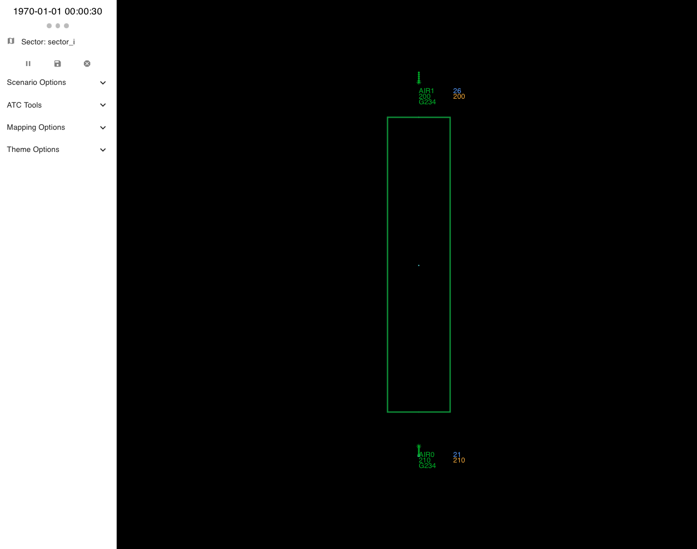

# Getting Started

For quick start, please make sure uv is installed [(installation guide)](https://docs.astral.sh/uv/getting-started/installation/) and run the following command in a terminal:

```bash
uvx bluebird-api@latest
```

then navigate to [http://localhost:8000/hmi/](http://localhost:8000/hmi/) on a browser.

This will open a radar HMI, initially with no scenario loaded.
To load a scenario, select `Load new scenario` at the top left of the window.
A window will appear in the middle of the screen, select `Artificial`, then `I-Sector Two Aircraft` and finally, `Load`.

<div style="text-align: center;" markdown>
{ width="600" }
</div>

With the scenario loaded, the aircraft and sector should now be visible in the radar. Clicking the play icon in the top left of the screen will make the simulation evolve making the aircraft move.

## How the packages fit together

The quick start above uses two of the four packages: `bluebird-api` runs the simulation, and the radar display is `bluebird-hmi`.

* `bluebird-dt` is the digital twin: the airspace, scenarios, aircraft, trajectory prediction, and the `Simulator` that moves them forward in time. The other Python packages are built on it, and it can be used on its own from Python.
* `bluebird-api` runs one `bluebird-dt` simulation in a server process. It serves the state of the simulation and accepts actions over HTTP, and evolves the simulation either on a timer, started with the play icon, or one request at a time.
* `bluebird-hmi` is the radar display, a React web app that polls `bluebird-api` for the state of the simulation. A built copy comes with `bluebird-api` and is served at `/hmi`, so the `bluebird-hmi` source is only needed to change the display.
* `bluebird-gymnasium` wraps `bluebird-dt` scenarios as Gymnasium environments for training reinforcement learning agents. Each environment builds and steps its own simulation in the agent's Python process, and can draw a radar with matplotlib. It doesn't use `bluebird-api` or the HMI.

Installing `bluebird-api` or `bluebird-gymnasium` also installs the version of `bluebird-dt` it was released with.

## Quick start for developing agents

Instructions for interfacing with the digital twin to make agents are available for:

* [using the gymnasium](bluebird-gymnasium/getting-started.md)
* [using the REST API from any language](bluebird-api/getting-started.md)
* [interacting directly with the digital twin](bluebird-dt/getting-started.md)

## ATC concepts

The ATM industry is niche and therefore we have provided an [introduction to the key concepts](atc/index.md) necessary to understand the problem.
